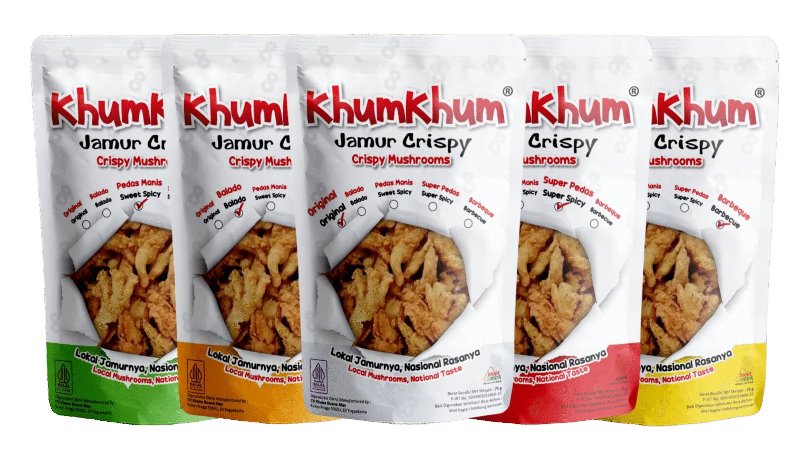
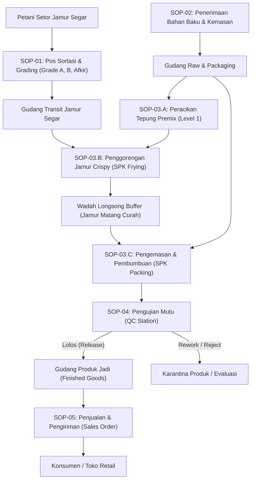
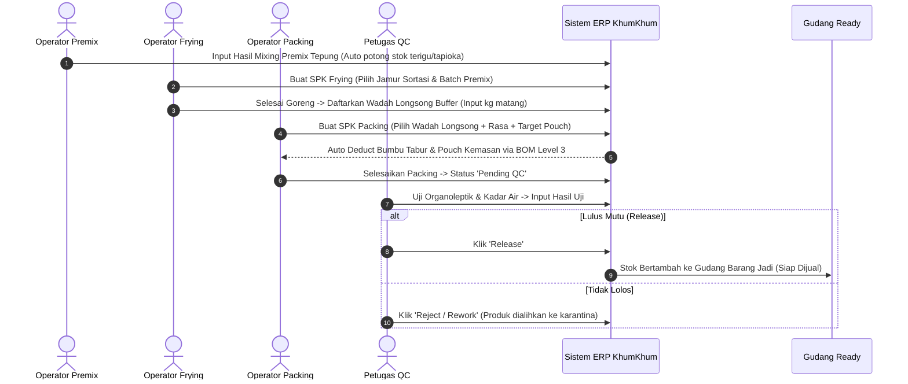

# STANDAR OPERASIONAL PROSEDUR (SOP) OPERASIONAL SISTEM KHUMKHUM ERP
## CV KHAIRA BUANA MANDIRI — MANUFAKTUR OLAHAN JAMUR CRISPY

<div align="center">



### **DOKUMEN INDUK TATA KELOLA & OPERASIONAL SISTEM TERPADU**
**Kode Dokumen:** SOP/ERP-KK/2026/001 | **Status Dokumen:** Edisi Resmi Berlaku  
**Versi:** 1.0 (Revisi Mutakhir) | **Tanggal Efektif:** November 2026  
**Klasifikasi:** Internal Dokumen Operasional Pabrik & Manajemen

---

### **LEMBAR PENGESAHAN DOKUMEN**

| Aktivitas | Nama / Posisi | Tanggal | Tanda Tangan / Validasi |
| :--- | :--- | :--- | :--- |
| **Disusun Oleh** | Tim Pengembang Sistem & Operasional | 08 November 2026 | *Tervalidasi Digital* |
| **Ditinjau Oleh** | Kepala Operasional Pabrik & PPIC | 08 November 2026 | *Tervalidasi Digital* |
| **Disetujui Oleh** | Direktur / General Manager CV Khaira Buana Mandiri | 08 November 2026 | *Disahkan Resmi* |

</div>

---

## DAFTAR ISI

1. [BAB I: PENDAHULUAN & KEBIJAKAN UMUM](#bab-i-pendahuluan--kebijakan-umum)
   - 1.1 Latar Belakang & Filosofi Sistem
   - 1.2 Tujuan Dokumen SOP
   - 1.3 Ruang Lingkup Operasional (*Seed-to-Shelf*)
   - 1.4 Kebijakan Dasar Sistem (*Zero Redundancy & Traceability*)
   - 1.5 Matriks Hak Akses & Tanggung Jawab (*RACI Matrix*)
2. [BAB II: MANAJEMEN AKUN & KEAMANAN SISTEM](#bab-ii-manajemen-akun--keamanan-sistem)
   - 2.1 Ketentuan Akun Pengguna
   - 2.2 Prosedur Masuk (*Login*) & Keluar (*Logout*)
   - 2.3 Penanganan Lupa Password & Pergantian Shift
3. [BAB III: PROSEDUR OPERASIONAL STANDAR PER MODUL](#bab-iii-prosedur-operasional-standar-per-modul)
   - [SOP-01: Penerimaan & Sortasi Jamur Segar dari Petani Mitra](#sop-01-penerimaan--sortasi-jamur-segar-dari-petani-mitra)
   - [SOP-02: Manajemen Bahan Baku, Kemasan, & Peringatan Stok Gudang](#sop-02-manajemen-bahan-baku-kemasan--peringatan-stok-gudang)
   - [SOP-03: Proses Manufaktur & Produksi 3 Tahap](#sop-03-proses-manufaktur--produksi-3-tahap)
     - 3.1 Sub-SOP 03.A: Peracikan Tepung Premix (Level 1)
     - 3.2 Sub-SOP 03.B: Penggorengan Jamur Crispy & Wadah Longsong Buffer (Level 2)
     - 3.3 Sub-SOP 03.C: Pembumbuan & Pengemasan Retail BOM Level 3 (Level 3)
   - [SOP-04: Kendali Mutu & Pelepasan Produk Jadi (*Quality Control*)](#sop-04-kendali-mutu--pelepasan-produk-jadi-quality-control)
   - [SOP-05: Pemenuhan Pesanan Penjualan, Faktur, & Pengiriman](#sop-05-pemenuhan-pesanan-penjualan-faktur--pengiriman)
   - [SOP-06: Perencanaan Produksi (PPIC) & AI Demand Forecasting](#sop-06-perencanaan-produksi-ppic--ai-demand-forecasting)
4. [BAB IV: PENUTUPAN HARIAN, JEJAK AUDIT, & PENELUSURAN BATCH](#bab-iv-penutupan-harian-jejak-audit--penelusuran-batch)
   - 4.1 Prosedur Rekonsiliasi Harian (*Daily Closing*)
   - 4.2 Prosedur Penelusuran Insiden Mutu (*Traceability / Recall*)
   - 4.3 Pemantauan Jejak Audit (*Audit Trail*)
5. [BAB V: PENANGANAN KENDALA OPERASIONAL & ANOMALI SISTEM](#bab-v-penanganan-kendala-operasional--anomali-sistem)
6. [BAB VI: LAMPIRAN & FORMULIR STANDAR PABRIK](#bab-vi-lampiran--formulir-standar-pabrik)

---

## BAB I: PENDAHULUAN & KEBIJAKAN UMUM

### 1.1 Latar Belakang & Filosofi Sistem
KhumKhum ERP dirancang dan diterapkan di lingkungan pabrik **CV Khaira Buana Mandiri** untuk mentransformasikan pencatatan manual berbasis buku/kertas menjadi ekosistem digital real-time. Sistem ini mengintegrasikan seluruh rantai pasok industri jamur crispy olahan: mulai dari penerimaan bahan mentah di pos timbang petani, peracikan premix, penggorengan higienis, pengemasan dengan formula bumbu presisi, kendali mutu bersertifikasi, hingga inventori pergudangan dan distribusi penjualan.

### 1.2 Tujuan Dokumen SOP
1. Memberikan pedoman baku dan tertib bagi seluruh staf pabrik dan manajemen dalam menggunakan sistem KhumKhum ERP.
2. Menjamin data operasional pabrik yang diinput ke dalam sistem memiliki validitas tinggi, akurat, dan tanpa jeda waktu (*real-time*).
3. Mencegah terjadinya kehilangan bahan, salah racik bumbu, kelebihan kemas (*overpack/underpack*), serta memastikan akuntabilitas perorangan atas setiap barang yang diproses.
4. Menjadi acuan audit kepatuhan standar mutu pangan (BPOM, Sertifikasi Halal, dan ISO).

### 1.3 Ruang Lingkup Operasional (*Seed-to-Shelf*)
SOP ini mencakup 7 unit kerja utama di lingkungan CV Khaira Buana Mandiri:
1. Pos Sortasi & Penerimaan Jamur Basah.
2. Gudang Bahan Baku, Bumbu, & Kemasan (*Raw & Packaging Warehouse*).
3. Stasiun Manufaktur (Ruang Premix, Area Frying/Penggorengan, dan Ruang Packing Bersih).
4. Pos Quality Control & Laboratorium Uji Organoleptik.
5. Gudang Produk Jadi (*Finished Goods Warehouse*).
6. Divisi Penjualan (*Sales & Dispatch*).
7. Perencanaan Produksi & Manajemen Eksekutif (*PPIC & Executive Management*).

### 1.4 Kebijakan Dasar Sistem
1. **Single Source of Truth (Satu Sumber Kebenaran):** Seluruh mutasi barang (masuk, pakai, susut, reject, jual) wajib diinput melalui KhumKhum ERP. Tidak dibenarkan adanya catatan bayangan di luar sistem.
2. **Zero Auto-Assumption:** Sistem tidak menduga-duga; setiap potongan stok bahan kemasan dan bumbu dihitung secara otomatis berdasarkan standard formula BOM (*Bill of Materials*) Level 3 saat SPK Packing diselesaikan.
3. **Traceability Guarantee:** Setiap nomor kemasan produk jadi yang keluar wajib memiliki riwayat tautan ke Nomor SPK Packing, Nomor Wadah Longsong Frying, Batch Penggorengan, Tanggal Sortasi, dan Nama Petani Pemasok.
4. **Disiplin Real-Time:** Dilarang menumpuk dokumen fisik untuk diinput di akhir hari atau esok hari (*backdated input*), kecuali terjadi force majeure (lampu padam/jaringan putus) yang telah diatur pada Bab V.

### 1.5 Matriks Hak Akses & Tanggung Jawab (*RACI Matrix*)

| Departemen / Modul | SORTING | WAREHOUSE | PREMIX | PRODUCTION | QC | SALES | MANAGEMENT | SUPER_ADMIN |
| :--- | :---: | :---: | :---: | :---: | :---: | :---: | :---: | :---: |
| **Sortasi Jamur Segar** | **R / A** | C | I | I | I | I | I | C |
| **Gudang Raw & Packaging** | I | **R / A** | C | C | I | I | I | C |
| **Peracikan Premix** | I | C | **R / A** | C | I | I | I | C |
| **Penggorengan (Frying SPK)** | I | C | I | **R / A** | I | I | I | C |
| **Pengemasan (Packing SPK)** | I | C | I | **R / A** | C | I | I | C |
| **Quality Control (QC)** | I | I | I | C | **R / A** | I | I | C |
| **Gudang Produk Jadi** | I | **R / A** | I | I | C | C | I | C |
| **Pesanan Penjualan (SO)** | I | C | I | I | I | **R / A** | I | C |
| **PPIC & AI Forecasting** | I | C | I | C | I | C | **R / A** | C |
| **Dashboard & Audit Log** | I | I | I | I | I | I | **A** | **R / A** |

*Keterangan: R = Responsible (Pelaksana), A = Accountable (Penanggung Jawab Penuh), C = Consulted (Pihak Terkait/Koordinasi), I = Informed (Penerima Informasi).*

---

## BAB II: MANAJEMEN AKUN & KEAMANAN SISTEM

### 2.1 Ketentuan Akun Pengguna
1. Setiap karyawan yang beroperasi di stasiun sistem wajib memiliki akun personal dengan email dan kata sandi mandiri sesuai jabatannya.
2. Dilarang keras meminjamkan akun atau berbagi kata sandi kepada rekan kerja lain, termasuk atasan langsung.
3. Setiap tindakan simpan, ubah, dan hapus dicatat otomatis dalam sistem bersama *User ID* dan cap waktu (*timestamp*).

### 2.2 Prosedur Masuk (*Login*) & Keluar (*Logout*)
1. Buka browser peramban (disarankan Google Chrome versi terbaru) pada komputer stasiun atau tablet kerja.
2. Akses alamat portal KhumKhum ERP pabrik.
3. Masukkan **Alamat Email Resmi** dan **Kata Sandi**.
4. Klik tombol **"Masuk ke Sistem"**.
5. Pastikan menu sidebar yang tampil telah sesuai dengan divisi kerja masing-masing.
6. Saat jam shift berakhir atau operator meninggalkan meja stasiun lebih dari 15 menit, operator **WAJIB** menekan avatar profil di sudut kanan atas dan memilih menu **"Keluar (Logout)"**.

### 2.3 Pergantian Shift & Pengamanan Stasiun
1. Operator shift pagi melakukan input penutupan batch sebelum operator shift sore memulai SPK baru.
2. Dilarang meninggalkan workstation dalam keadaan akun aktif tanpa pengawasan.

---

## BAB III: PROSEDUR OPERASIONAL STANDAR PER MODUL



---

### SOP-01: Penerimaan & Sortasi Jamur Segar dari Petani Mitra
*Kode Prosedur: SOP-KK-OPS-01 | Pelaksana: Operator SORTING | Dokumen Acuan: Surat Setor Timbang Petani*

#### 1. Tujuan
Memastikan jamur tiram putih yang disetor mitra petani memenuhi standar spesifikasi pabrik, menimbang berat kotor (*gross*), berat bersih (*netto*), memilah mutu (Grade A, B, dan Afkir/Susut), serta mencatat harga beli secara transparan.

#### 2. Prosedur Kerja
1. **Pemeriksaan Fisik Jamur Datang:**
   - Operator menerima keranjang jamur segar di pos timbang.
   - Periksa kondisi visual: Jamur tidak boleh berlendir, tidak berbau asam/busuk, tidak basah berlebihan akibat siraman air buatan, dan tudung utuh.
2. **Penimbangan & Input Data:**
   - Letakkan keranjang di atas timbangan digital pos sortasi.
   - Buka menu **Sortasi** (`/sorting`) pada KhumKhum ERP.
   - Pilih nama **Petani Pemasok** yang terdaftar di sistem.
   - Masukkan **Total Bobot Jamur Diterima (kg)**.
3. **Grading Mutu:**
   - Pisahkan jamur ke dalam tiga wadah sortir:
     - **Grade A:** Tudung lebar normal, bersih, ketebalan ideal untuk keripik premium.
     - **Grade B:** Tudung sobek kecil/ukuran kecil, namun masih segar dan layak goreng.
     - **Afkir / Kotoran:** Batang akar berkayu tebal, jamur cokelat/busuk, dan sisa media tanam (baglog).
   - Timbang bobot masing-masing kategori, lalu input nilai:
     - *Bobot Grade A (kg)*
     - *Bobot Grade B (kg)*
     - *Bobot Afkir (kg)*
4. **Verifikasi & Penyimpanan Data:**
   - Sistem akan menghitung otomatis: Persentase Rendemen Sortasi dan Total Nilai Pembayaran Petani.
   - Klik tombol **"Simpan Data Sortasi"**.
   - Cetak / catat Nomor Tiket Sortasi pada nota serah terima petani.
   - Jamur Grade A dan B dipindahkan ke ruang penirisan/transit produksi penggorengan.

---

### SOP-02: Manajemen Bahan Baku, Kemasan, & Peringatan Stok Gudang
*Kode Prosedur: SOP-KK-OPS-02 | Pelaksana: Staf WAREHOUSE | Dokumen Acuan: Surat Jalan Suplier / PO*

#### 1. Tujuan
Menjaga ketersediaan bahan pendukung (tepung terigu, tepung tapioka, beras, maizena, bumbu tabur aneka rasa, standing pouch, toples, aluminium seal, karton dus, minyak goreng, dan gas) agar tidak pernah menghentikan proses manufaktur.

#### 2. Prosedur Penerimaan Barang Datang (Inbound)
1. Periksa surat jalan dari suplier (nama bahan, nomor batch produsen, tanggal kedaluwarsa, jumlah fisik, dan segel kemasan).
2. Buka menu **Penerimaan Barang** (`/receiving`) atau **Inventori Bahan Baku**.
3. Pilih nama material, nomor batch suplier, tanggal kedaluwarsa (*expired date*), serta kuantitas aktual yang diterima.
4. Klik **"Terima & Tambah ke Stok"**. Saldo stok gudang akan bertambah otomatis.
5. Tempelkan label internal gudang yang memuat tanggal kedaluwarsa untuk memastikan prinsip **FIFO (First In, First Out)**.

#### 3. Prosedur Pemantauan Peringatan Dini Stok (ROP - Reorder Point)
1. Setiap staf gudang masuk ke sistem, wajib memeriksa **Ikon Lonceng Notifikasi** di bilah atas (*topbar*).
2. **Kategori Alert:**
   - **Kuning (Warning - Stok Menipis):** Kuantitas bahan $\le$ Nilai ROP. Staf gudang wajib membuat permintaan pembelian (*Purchase Request*) ke pengadaan.
   - **Merah (Danger - Stok Kritis/Habis):** Stok habis atau $\le 20\%$ dari ROP. Staf gudang wajib segera berkoordinasi darurat dengan kepala pabrik dan suplier prioritas.
3. Setelah pesanan suplier tiba dan diinput ke sistem, status notifikasi akan pulih otomatis menjadi normal (hijau).

#### 4. Prosedur Stock Opname Bulanan
1. Setiap akhir bulan kalender, staf gudang melakukan perhitungan fisik (*physical counting*) seluruh persediaan.
2. Buka modul **Stock Opname**.
3. Masukkan kuantitas hasil hitung fisik ke kolom *Stok Nyata*.
4. Jika terdapat selisih (*variance*), sistem mewajibkan pengisian alasan selisih (misal: kebocoran kemasan, sampling QC, atau susut penimbangan).
5. Konfirmasi penyesuaian stok disetujui bersama Kepala Gudang dan Manajemen.

---

### SOP-03: Proses Manufaktur & Produksi 3 Tahap
*Kode Prosedur: SOP-KK-OPS-03 | Pelaksana: Tim PREMIX & PRODUCTION*

Proses manufaktur KhumKhum dibagi menjadi 3 stasiun terpisah untuk menjamin higienitas, efisiensi waktu kerja, dan ketertelusuran formula:

```
[Level 1: Ruang Premix] ---> [Level 2: Dapur Goreng (Frying)] ---> [Level 3: Ruang Packing Bersih]
Peracikan Tepung Premix       Penggorengan & Longsong Buffer       Penimbangan, Bumbu & Kemasan
```

#### 3.1 Sub-SOP 03.A: Peracikan Tepung Premix (Level 1)
- **Pelaksana:** Operator Stasiun `PREMIX`.
- **Langkah Operasional:**
  1. Buka menu **Peracikan Premix** (`/production/premix`).
  2. Pilih formula premix yang akan dibuat (Premix Original, Premix Super Crispy, dsb).
  3. Masukkan target jumlah batch yang akan diaduk. Sistem akan menampilkan rincian kebutuhan timbangan per karung/kg: Terigu Kunci, Cakra, Tapioka, Maizena, Tepung Beras, dan Bumbu Dasar.
  4. Ambil bahan dari rak staging gudang, lakukan penimbangan presisi menggunakan timbangan digital.
  5. Masukkan ke mesin mixer tepung, jalankan proses pencampuran selama waktu standar (15 menit).
  6. Setelah homogen, tuang ke dalam wadah tertutup kedap udara dan tempelkan label Batch Premix.
  7. Klik tombol **"Selesaikan Batch Premix"** di sistem. Saldo bahan tepung mentah di gudang akan terpotong otomatis, dan stok Tepung Premix siap pakai akan bertambah.

#### 3.2 Sub-SOP 03.B: Penggorengan Jamur Crispy & Wadah Longsong Buffer (Level 2)
- **Pelaksana:** Operator Stasiun `PRODUCTION (Frying)`.
- **Langkah Operasional:**
  1. Buka menu **Produksi > SPK Penggorengan** (`/production/frying`).
  2. Klik **"Buat SPK Frying Baru"**.
  3. Pilih sumber jamur: Tentukan Nomor Batch Sortasi Jamur Segar yang telah disiapkan (Grade A atau Grade B) dan jumlah kg jamur basah yang digunakan.
  4. Pilih Nomor Batch Tepung Premix yang digunakan.
  5. Catat jam mulai penggorengan di sistem. Pastikan suhu minyak pada wajan penggorengan mencapai $160^\circ\text{C} - 170^\circ\text{C}$.
  6. Lakukan proses penepungan basah-kering dan penggorengan hingga jamur mengapung, berwarna kuning keemasan (*golden yellow*), dan kadar air habis.
  7. Tiriskan jamur menggunakan mesin *spinner* minyak selama 3–5 menit hingga benar-benar kering dari minyak berlebih.
  8. **Manajemen Wadah Longsong Buffer:**
     - Jamur crispy matang curah dimasukkan ke wadah penampungan steril (disebut **Wadah Longsong**).
     - Timbang bobot bersih jamur matang pada wadah longsong tersebut.
     - Input ke sistem:
       - **ID / Nomor Wadah Longsong** (contoh: `LS-20261108-01`).
       - **Bobot Jamur Matang (kg)**.
     - Klik **"Simpan Hasil Penggorengan"**.
     - Tempelkan barcode/stiker Nomor Longsong fisik pada wadah sebelum dipindahkan ke ruang pengemasan.

#### 3.3 Sub-SOP 03.C: Pembumbuan & Pengemasan Retail BOM Level 3 (Level 3)
- **Pelaksana:** Operator Stasiun `PRODUCTION (Packing)`.
- **Langkah Operasional:**
  1. Buka menu **Produksi > SPK Pengemasan Retail** (`/production/packing`).
  2. Klik **"Buat SPK Packing Baru"**.
  3. Pilih **Nomor Wadah Longsong** yang akan dikemas. Sistem secara otomatis menampilkan sisa bobot jamur matang yang tersedia di wadah tersebut.
  4. Pilih **Produk Retail Tujuan** (contoh: *KhumKhum Crispy Balado 60g*, *BBQ 75g*, dsb).
  5. Masukkan **Target Kuantitas Kemasan (Pcs/Pouch)** yang ingin dibuat.
  6. **Validasi BOM Level 3 Otomatis:**
     - Sistem secara cerdas menghitung kebutuhan:
       - *Jamur Matang Curah (gram)*: sesuai takaran standar produk.
       - *Bumbu Tabur (gram)*: sesuai formula gramasi varian rasa.
       - *Bahan Kemasan (pcs)*: Standing pouch, seal aluminium, dan stiker label.
     - Jika stok bumbu atau kemasan di gudang tidak mencukupi, sistem menampilkan peringatan merah dan tombol konfirmasi terkunci.
  7. Operator melakukan pembumbuan pada drum mixer berputar hingga bumbu merata sempurna pada jamur.
  8. Lakukan penimbangan takaran per pouch menggunakan timbangan presisi kalibrasi (toleransi $\pm 0.5$ gram).
  9. Masukkan jamur berbumbu ke dalam kemasan standing pouch, rekatkan mulut kantong dengan mesin continuous band sealer bertanggal kedaluwarsa.
  10. Setelah seluruh target selesai dikemas, operator menginput **Jumlah Pouch Jadi Aktual** dan **Sisa Keremahan/Susut (gram)**.
  11. Klik tombol **"Selesaikan SPK Packing"**.
  12. Hasil kemasan otomatis berpindah status ke: **"Menunggu Uji Mutu QC (Pending QC)"**.

---

### SOP-04: Kendali Mutu & Pelepasan Produk Jadi (*Quality Control*)
*Kode Prosedur: SOP-KK-OPS-04 | Pelaksana: Staf QC (Quality Control) | Dokumen Acuan: Standar Mutu Pangan SNI/BPOM*

#### 1. Tujuan
Memastikan setiap bungkus jamur crispy yang beredar di pasaran memiliki rasa, kerenyahan, kadar air, gramasi, dan higienitas kemasan yang 100% memenuhi standar kelayakan konsumsi.

#### 2. Prosedur Sampling & Pengujian
1. Staf QC membuka modul **Quality Control** (`/qc`).
2. Periksa daftar **Batch Menunggu Uji**.
3. Ambil 3 pouch sampel acak dari setiap batch SPK Packing yang baru selesai:
   - Sampel 1: Awal proses packing.
   - Sampel 2: Pertengahan proses packing.
   - Sampel 3: Akhir proses packing.
4. Lakukan pengujian di meja uji QC:
   - **Uji Kerapatan Seal:** Tekan pouch perlahan; pastikan tidak ada kebocoran udara pada sambungan pemanas.
   - **Uji Organoleptik:** Evaluasi warna (tidak gosong), rasa bumbu (merata, tidak apek), dan tingkat kerenyahan (*crunchiness*).
   - **Uji Kadar Air (Moisture Content):** Pastikan kadar air di bawah batas kritis ($< 3\%$).
   - **Uji Ketepatan Netto:** Timbang berat total dikurangi bobot tara kantong kosong.

#### 3. Penetapan Status di Sistem
Pada formulir uji batch di KhumKhum ERP, staf QC memilih salah satu keputusan:
- **STATUS RELEASE (LOLOS MUTU):**
  - Seluruh parameter memenuhi syarat.
  - Klik **"Approve & Release ke Gudang Produk Jadi"**.
  - Produk otomatis masuk ke saldo stok jual (*ready stock*) di Gudang Barang Jadi, dan siap dipesan oleh bagian Sales.
- **STATUS REWORK (KEMAS ULANG):**
  - Kegagalan minor pada seal atau tanggal cetak, namun kualitas jamur masih prima.
  - Produk dikembalikan ke stasiun packing untuk dikemas ulang dengan kemasan baru.
- **STATUS REJECT (TOLAK / AFKIR):**
  - Kegagalan fatal (misal: gosong, bau tengik, kadar air tinggi).
  - Produk dimusnahkan dan dicatat sebagai susut kerugian produksi (*waste loss*).

---

### SOP-05: Pemenuhan Pesanan Penjualan, Faktur, & Pengiriman
*Kode Prosedur: SOP-KK-OPS-05 | Pelaksana: Staf SALES & Logistik*

#### 1. Tujuan
Mengelola pesanan dari distributor, agen, reseller, dan marketplace, memastikan barang yang dikirim adalah produk yang telah lulus QC Release, serta mencatat status pembayaran dan pengiriman secara tepat waktu.

#### 2. Alur Pembuatan Sales Order (SO)
1. Terima pesanan resmi dari pembeli (via WhatsApp Business, Marketplace, atau PO Tertulis).
2. Buka menu **Penjualan > Pesanan Penjualan** (`/sales`).
3. Klik **"Buat Pesanan Baru"**.
4. Pilih atau daftarkan **Nama Pelanggan / Toko**.
5. Pilih varian produk dan masukkan kuantitas pesanan:
   - Sistem secara otomatis memvalidasi ketersediaan stok fisik yang berstatus *Release*.
   - Jika stok tidak mencukupi, sistem menampilkan peringatan jumlah maksimal yang dapat dipesan.
6. Tentukan harga jual, diskon (jika ada), serta biaya ongkos kirim/ekspedisi.
7. Pilih metode pembayaran: **Tunai (Cash)**, **Transfer Bank**, atau **Tempo / Piutang (Kredit)** dengan tanggal jatuh tempo.
8. Klik **"Terbitkan Sales Order"**.

#### 3. Alur Pengeluaran Barang & Surat Jalan
1. Tim Gudang Barang Jadi menerima notifikasi pesanan penjualan.
2. Siapkan kardus produk sesuai nomor batch yang ditentukan pada Surat Jalan (menerapkan prinsip FIFO).
3. Setelah barang dimuat ke kendaraan kurir/ekspedisi, staf logistik membuka detail order di sistem dan mengklik **"Barang Diserahkan ke Ekspedisi / Dikirim"**.
4. Saldo produk jadi di gudang berkurang seketika.
5. Setelah pembeli mengonfirmasi penerimaan barang dan pembayaran tervalidasi, staf Sales mengubah status menjadi **"Pesanan Selesai (Completed)"**.

---

### SOP-06: Perencanaan Produksi (PPIC) & AI Demand Forecasting
*Kode Prosedur: SOP-KK-OPS-06 | Pelaksana: Tim PPIC & MANAGEMENT*

#### 1. Tujuan
Mencegah terjadinya kehabisan stok barang jadi saat lonjakan permintaan (*stockout*) dan mencegah penumpukan bahan mentah yang berisiko busuk melalui proyeksi kebutuhan berbantuan kecerdasan buatan (*AI Forecasting*).

#### 2. Prosedur Evaluasi Peramalan Permintaan (AI Forecasting)
1. Setiap hari Senin awal pekan, staf PPIC dan Manajer Operasional membuka menu **AI Forecasting** (`/forecasting`).
2. Tinjau grafik peramalan berbasis metode **Holt-Winters Exponential Smoothing** yang memadukan data historis penjualan harian, tren musiman (seperti liburan dan hari besar), serta variasi rasa.
3. Evaluasi nilai proyeksi kebutuhan penjualan untuk 14 hingga 30 hari ke depan.
4. Buka menu **PPIC Plan** (`/ppic`):
   - Masukkan target produksi mingguan berdasarkan angka ramalan AI.
   - Sistem akan mengalkulasi total kebutuhan estimasi: Jamur Tiram Basah (kg), Tepung Premix (kg), Bumbu Rasa (gram), dan Standing Pouch (lembar).
5. Tim PPIC menerbitkan jadwal kontrak pasokan jamur ke kelompok tani mitra agar pasokan jamur basah harian stabil sesuai kapasitas goreng pabrik.

---

## BAB IV: PENUTUPAN HARIAN, JEJAK AUDIT, & PENELUSURAN BATCH

### 4.1 Prosedur Rekonsiliasi Harian (*Daily Closing*)
1. Dilaksanakan setiap pukul 17:30 WIB oleh Supervisor Pabrik.
2. Buka **Dashboard Harian** (`/dashboard/daily`).
3. Cocokkan:
   - Total jamur basah yang disortasi vs jamur yang masuk wajan penggorengan.
   - Total jamur matang dalam wadah longsong vs jumlah yang telah dikemas.
   - Nilai rendemen hasil goreng (Rendemen ideal: $30\% - 36\%$). Jika rendemen di bawah $28\%$, lakukan evaluasi kadar air jamur basah atau proses penirisan spinner.
4. Pastikan tidak ada SPK gantung yang belum diselesaikan statusnya tanpa keterangan tertulis.

### 4.2 Prosedur Penelusuran Insiden Mutu (*Traceability / Recall*)
Jika terdapat keluhan pelanggan atas suatu produk (misal: kemasan bocor atau rasa hambar):
1. Minta nomor kode batch yang tertera di bagian belakang kemasan dari pelanggan (contoh: `LOT-KK-20261108-BAL60-03`).
2. Buka modul **Traceability (Penelusuran Produk)** (`/traceability`).
3. Masukkan kode batch tersebut ke kolom pencarian sistem.
4. Dalam hitungan detik, sistem akan menampilkan silsilah digital lengkap:
   - Jam berapa produk dikemas dan operator packing yang bertugas.
   - Hasil uji QC pada batch tersebut (nilai kadar air dan nama petugas QC).
   - Nomor Wadah Longsong jamur matang yang dipakai.
   - Nomor wajan penggorengan, tanggal goreng, dan batch tepung premix.
   - Tanggal sortasi jamur basah dan nama petani mitra yang menyetor.
5. Manajemen dapat mengisolasi nomor batch terkait di gudang (*freeze stock*) secara terarah tanpa perlu menarik produk lain yang aman.

### 4.3 Pemantauan Jejak Audit (*Audit Trail*)
Seluruh aktivitas perubahan data finansial, penghapusan data master, dan pembatalan transaksi dicatat secara permanen di menu **Audit Log** (`/settings/audit-logs`). Supervisor dan Auditor Internal melakukan pengecekan berkala terhadap histori manipulasi data untuk mencegah fraud atau kelalaian kerja.

---

## BAB V: PENANGANAN KENDALA OPERASIONAL & ANOMALI SISTEM

| Jenis Kendala | Gejala di Lapangan | Prosedur Solusi Standar | Penanggung Jawab |
| :--- | :--- | :--- | :--- |
| **Koneksi Internet / Jaringan Terputus** | Halaman tidak dapat dimuat atau gagal menyimpan data. | 1. Jangan me-refresh berulang kali.<br>2. Gunakan **Buku Cadangan Darurat Fisik (Form Kontinjensi)** untuk mencatat timbangan manual sementara.<br>3. Hubungi tim IT/Super Admin.<br>4. Segera input rekapan manual ke sistem setelah jaringan normal kembali maksimal 2 jam setelah pemulihan. | Staf IT / Staf Terkait |
| **Peringatan Stok Merah saat SPK Packing** | Tombol konfirmasi SPK Packing tidak dapat diklik karena bumbu/kemasan habis di sistem. | 1. Dilarang memaksa pengemasan tanpa input bumbu.<br>2. Cek fisik ke gudang apakah ada barang baru datang yang belum di-receiving.<br>3. Jika ada fisik riil, staf gudang wajib input penerimaan barang terlebih dahulu ke sistem.<br>4. Muat ulang halaman SPK Packing dan lanjutkan proses. | Tim Gudang & Produksi |
| **Selisih Timbangan Tiba-Tiba** | Bobot jamur matang pada wadah longsong berbeda dengan saat penimbangan packing. | 1. Kalibrasi ulang timbangan digital menggunakan anak timbang standar.<br>2. Periksa apakah ada wadah longsong yang tertukar nomor labelnya.<br>3. Jika terjadi susut alami, catat selisih pada kolom penyesuaian susut produksi dengan persetujuan Supervisor. | Supervisor Produksi |
| **Salah Input Data Transaksi** | Operator salah memasukkan angka kg sortasi atau varian produk. | 1. Operator tidak diperkenankan menghapus data secara sepihak.<br>2. Buat laporan revisi ke **Super Admin** dengan menyertakan bukti nota timbang fisik.<br>3. Super Admin melakukan koreksi transaksi yang akan terekam di Audit Trail. | Super Admin |

---

## BAB VI: LAMPIRAN & FORMULIR STANDAR PABRIK

### Lampiran 1: Alur Ringkas Tiga Tahap Produksi


### Lampiran 2: Indeks Menu & Tautan Navigasi Cepat Sistem
- **Pos Sortasi Jamur:** `/sorting`
- **Penerimaan Bahan Baku Suplier:** `/receiving`
- **Manajemen Inventori & ROP:** `/warehouse`
- **Peracikan Tepung Premix (Level 1):** `/production/premix`
- **Penggorengan & Wadah Longsong (Level 2):** `/production/frying`
- **Pengemasan & Formula Rasa (Level 3):** `/production/packing`
- **Pos Uji Mutu Quality Control:** `/qc`
- **Pesanan Penjualan & Tagihan:** `/sales`
- **Perencanaan PPIC & Kapasitas:** `/ppic`
- **Kecerdasan Buatan Peramalan Permintaan:** `/forecasting`
- **Penelusuran Produk (*Traceability*):** `/traceability`
- **Jejak Audit Sistem (*Audit Log*):** `/settings/audit-logs`

---
*Dokumen SOP ini sah dan mengikat seluruh jajaran personil operasional CV Khaira Buana Mandiri sejak tanggal diterbitkan. Setiap pembaruan atau revisi klausul wajib melalui peninjauan Tim Manajemen dan persetujuan Direktur Utama.*

