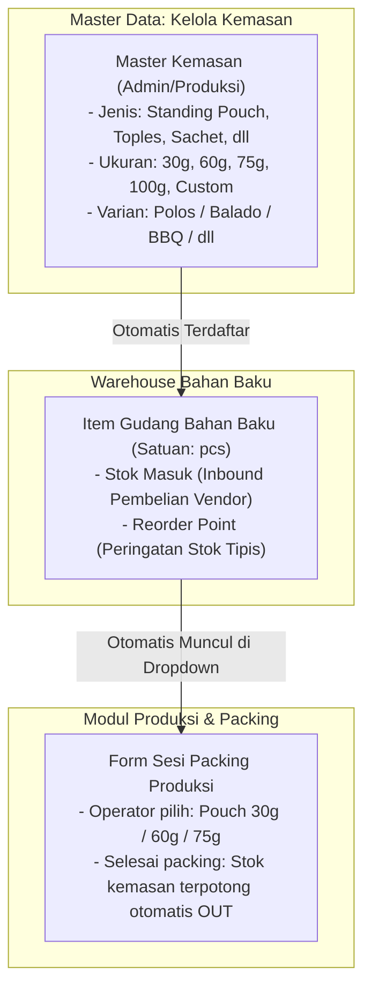

# Plan 5: Master Manajemen Kemasan Dinamis & Terintegrasi Warehouse
**Sistem ERP KhumKhum Jamur Crispy (CV Khaira Buana Mas)**

---

## 💡 1. Latar Belakang & Masalah
Di pabrik KhumKhum:
1. **Ukuran dan Jenis Kemasan Terus Berkembang:**
   - Saat ini mungkin memakai kemasan 100g dan Toples.
   - Ke depan ada variasi ukuran baru: **30 gram (kemasan hemat/ekonomis)**, **60 gram**, **75 gram**, atau kemasan khusus oleh-oleh / hampers.
   - Jenis kemasannya pun bisa bertambah: *Standing Pouch Zipper*, *Pouch Bantal Alumunium*, *Toples Jar*, *Sachet Mini*, hingga *Kardus Box*.
2. **Kemasan Fisik Adalah Stok Bahan Baku di Gudang:**
   - Kemasan kosong dibeli dari vendor percetakan dalam satuan **`pcs`**.
   - Stoknya disimpan di **Warehouse Bahan Baku**.
   - Saat operator packing membungkus jamur, stok kemasan `pcs` tersebut harus otomatis terpotong.
3. **Kebutuhan Pengguna di Master Data:**
   - Butuh menu khusus yang mudah dan fleksibel untuk **menambah, mengedit, atau mengganti ukuran dan jenis kemasan** tanpa harus memodifikasi kodingan.

---

## 🏗️ 2. Arsitektur Alur Kemasan (Master Data $\to$ Gudang $\to$ Produksi)

---

## 📋 3. Desain Fitur di Master Data (`/master` & `/master/raw-materials?tab=PACKAGING`)

### A. Titik Masuk di Pusat Master Data (`/master`)
Di halaman Pusat Master Data, pada grup **Gudang & Item**, kita tambahkan kartu tersendiri:
* **Kartu: "Bahan Kemasan (Packaging)"**
  * *Deskripsi:* Kelola spesifikasi jenis kemasan (Pouch, Toples), ukuran gramasi (30g, 60g, 75g, dll), dan stok minimum.
  * *Tautan:* Langsung membuka filter tab kemasan di `/master/raw-materials?tab=PACKAGING`.

---

### B. Form Tambah / Edit Kemasan Dinamis (*Dynamic Packaging Modal/Drawer*)

Saat menekan tombol `[+ Tambah Kemasan Baru]` atau `[✏️ Edit Kemasan]`, form menyediakan input yang sangat fleksibel:

1. **Jenis / Tipe Kemasan:**
   - Dropdown pilihan: *Standing Pouch, Toples Jar, Pouch Bantal, Sachet, Kardus Box, dll.*
   - Opsi `[+ Tambah Jenis Baru]`: Jika ada jenis wadah baru yang belum terdaftar.
2. **Ukuran / Gramasi Kemasan:**
   - Pilihan cepat chip: `[ 30g ]` `[ 60g ]` `[ 75g ]` `[ 100g ]` `[ 150g ]` `[ 250g ]` `[ 500g ]`
   - Input manual bebas (*Custom Weight*): Misalnya `40g` atau `120g`.
3. **Varian Cetakan Desain:**
   - *Universal / Polos (Bisa untuk semua rasa)*
   - *Khusus Cetak Sablon (Original / Balado / BBQ / Pedas Manis / Super Pedas)*
4. **Integrasi Stok Warehouse Bahan Baku:**
   - Satuan: Otomatis **`pcs`** (buah/lembar kemasan).
   - Minimum Stok & ROP: Misal ROP `500 pcs` (sistem memberi peringatan jika plastik pouch sisa sedikit agar segera order ke percetakan).
5. **Tombol Auto-Generate Kode & Nama:**
   - Contoh: Pilih jenis *Standing Pouch* + Rasa *Balado* + Ukuran *60g* $\to$ Sistem otomatis membuatkan:
     - Nama: `Packaging Standing Pouch Balado 60g`
     - Kode: `PKG-PCH-BLD-60G`

---

## 🔄 4. Dampak Langsung ke Modul Lain (Zero Hardcoding)

1. **Ke Warehouse Bahan Baku (`/warehouse`):**
   - Kemasan 30g, 60g, 75g langsung tampil sebagai item bahan baku dengan kartu stok masing-masing.
   - Tim gudang bisa mencatat pembelian kemasan (Inbound) dari percetakan.
2. **Ke Form Packing Produksi (`/production`):**
   - Dropdown tipe dan ukuran kemasan di modal packing **tidak lagi memakai array kaku di kodingan**, melainkan membaca langsung data aktif dari Master Kemasan.
   - Begitu admin menambah kemasan "Standing Pouch 30g" di Master Data, detik itu juga operator packing di lantai pabrik bisa memilih ukuran 30g!
3. **Ke Pemotongan Otomatis Gudang (*Auto-Deduct*):**
   - Saat operator menginput: *"Packing 200 pcs rasa Balado ukuran 60g"*, sistem memotong tepat **200 lembar** `Packaging Standing Pouch Balado 60g` dari gudang bahan baku.

---

## 🛠️ 5. Rencana Langkah Pengerjaan

1. **Penyempurnaan Master Data (`src/app/(shell)/master/raw-materials/page.tsx` & `/master/page.tsx`):**
   - Pastikan opsi ukuran kemasan memuat `30g`, `60g`, `75g`, `100g`, dan input custom.
   - Tambahkan kartu langsung "Bahan Kemasan" di Pusat Master Data (`/master`).
2. **Dinamisasi Dropdown di Form Packing (`src/app/(shell)/production/page.tsx`):**
   - Mengambil daftar tipe dan ukuran kemasan langsung dari database master bahan baku kategori `Packaging`.
3. **Koneksi Auto-Deduct Stok Kemasan di Server Action (`src/actions/production.ts`):**
   - Memastikan saat packing dicatat, stok kemasan terpilih otomatis berkurang sejumlah pcs yang dipacking.
